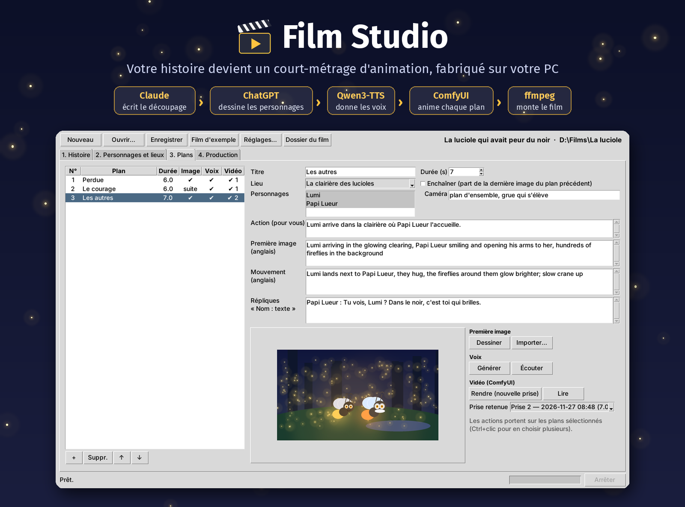
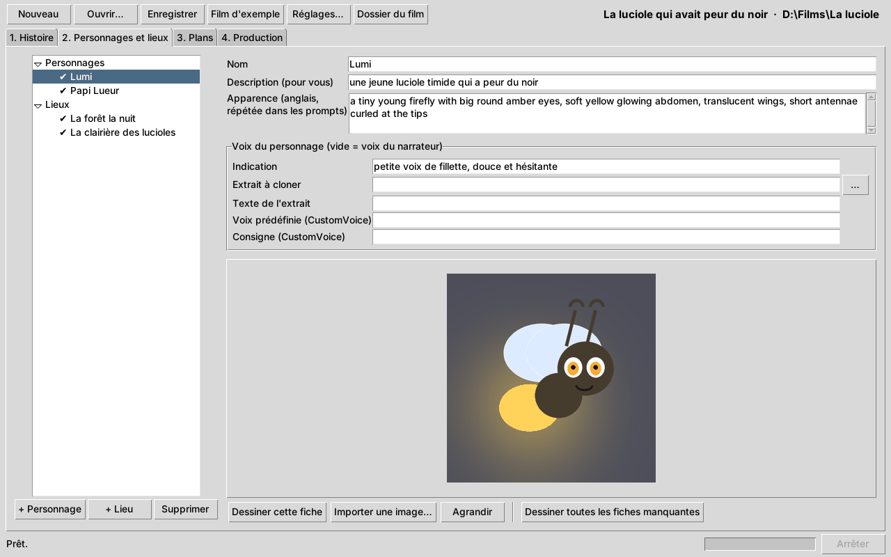
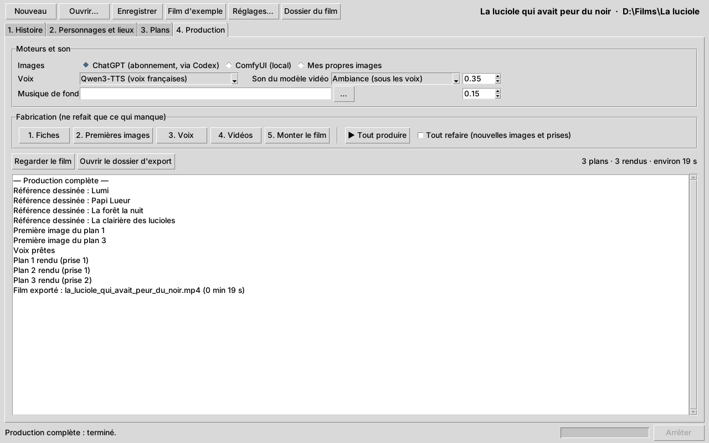

# Film Studio



**Des courts-métrages d'animation par IA, fabriqués sur votre PC, avec des personnages qui restent les mêmes d'un plan à l'autre.**

Vous écrivez votre idée en quelques phrases. Film Studio s'occupe du reste :

1. **Le découpage.** Claude écrit les personnages, les lieux et les plans, avec leurs répliques. Il passe par votre abonnement, sans clé API. Vous pouvez aussi utiliser Ollama en local, ou copier-coller le prompt dans l'IA de votre choix.
2. **Les fiches de référence.** ChatGPT dessine une fiche pour chaque personnage et chaque lieu. Il passe lui aussi par votre abonnement, sans clé API.
3. **La première image de chaque plan.** ChatGPT la dessine en recevant les fiches. Les personnages gardent ainsi la même apparence.
4. **Les voix.** Qwen3-TTS lit les répliques en français. Chaque personnage peut avoir sa propre voix (clonée ou prédéfinie).
5. **Les vidéos.** ComfyUI anime chaque plan sur votre carte graphique, avec le modèle de votre choix (LTX-2.5, Wan…). Un plan peut repartir de la dernière image du précédent, pour un enchaînement sans coupure.
6. **Le montage.** ffmpeg assemble les plans, mixe les voix, le son du modèle et la musique, normalise le volume et écrit les sous-titres (.srt).

Rien n'est figé. Chaque plan garde ses prises : vous pouvez en refaire une, choisir la meilleure, corriger une réplique ou remplacer une image. Seul ce qui a changé est refait.

## Aperçu

| Personnages et lieux | Production |
|---|---|
|  |  |

Chaque personnage a sa fiche de référence et peut avoir sa propre voix. Un seul bouton enchaîne les fiches, les premières images, les voix, les vidéos et le montage.

## Ce qu'il faut

| | Obligatoire ? | Rôle |
|---|---|---|
| Windows 10/11 et une carte NVIDIA (16 Go de mémoire vidéo ou plus conseillés) | oui | rendu des vidéos |
| ComfyUI avec un modèle image → vidéo (LTX-2.5 conseillé) : `install.bat` installe les deux | oui | vidéos |
| Abonnement Claude (Pro ou Max) + Claude Code | non | découpage (sinon Ollama ou copier-coller) |
| Abonnement ChatGPT + Codex | non | fiches et premières images (sinon ComfyUI ou vos images) |
| Un environnement Python avec [Qwen3-TTS](https://github.com/QwenLM/Qwen3-TTS) | non | voix françaises |

## Installation

1. Téléchargez le dépôt (bouton **Code → Download ZIP**) et décompressez-le.
2. Double-cliquez sur **`install.bat`**. Il installe Python si besoin, puis les dépendances, et crée un raccourci sur le Bureau. Il propose aussi :
   - d'installer et de connecter Claude Code et Codex ;
   - d'installer ComfyUI (avec l'outil officiel comfy-cli) ;
   - de télécharger les modèles vidéo LTX-2.5 ;
   - de préparer le workflow officiel « LTX-2.5 Image to Video », converti automatiquement au format API.
3. C'est prêt. Film Studio démarre et arrête ComfyUI tout seul quand il en a besoin. Le [guide](docs/GUIDE.md) explique comment utiliser un autre workflow si vous le souhaitez.

Si Whiteboard Studio est installé, Film Studio reprend ses réglages au premier lancement : Qwen3-TTS, voix clonée, Ollama, Claude Code et Codex.

## Premier film en 5 minutes

1. **Film d'exemple** charge « La luciole qui avait peur du noir » : 3 plans, 2 personnages et 2 lieux.
2. Cliquez sur **Enregistrer** et choisissez un dossier.
3. Dans l'onglet **4. Production**, cliquez sur **▶ Tout produire**.
4. **Regarder le film**.

## Ligne de commande

```
python -m filmstudio exemple "D:\Films\Luciole"
python -m filmstudio produire "D:\Films\Luciole"
python -m filmstudio etape videos "D:\Films\Luciole" --plans 2,3 --refaire
python -m filmstudio verifier-comfy
python -m filmstudio verifier-ia --outil codex
```

## Publier sur GitHub

Double-cliquez sur **`publier_github.bat`**. La première fois, il crée le dépôt sur votre compte. Les fois suivantes, il envoie vos modifications.

## Licence

MIT. Film Studio ne contient aucun modèle d'IA. Les modèles que vous utilisez dans ComfyUI ont leur propre licence : vérifiez-la avant tout usage commercial. Le [guide](docs/GUIDE.md#licences-des-modèles) donne les principaux cas.
